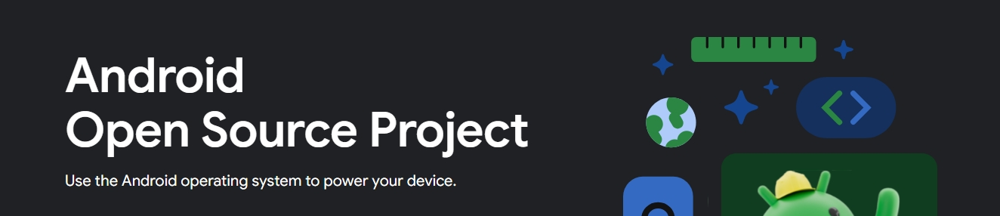

Effective in 2026, to align with our trunk stable development model and ensure platformstability for the ecosystem, we will publish source code to AOSP in Q2 and Q4. For building and contributing to AOSP, use android-latest-release. The android-latest-release manifest branch will always reference the most recent release pushed to AOSP. For more information, see [Changes to AOSP](https://source.android.com//).

Automotive
Advanced windowing with Scalable UI
In Android 17 and higher, use Scalable UI to build sophisticated, dynamic, and multi-panel user experiences in cars. Add WindowManager invariants, configure a setup wizard, and customize system and navigation bars. For more information, see Advanced windowing with Scalable UI.

Software defined vehicle
In Android 17 and higher, you can use the software-defined vehicle (SDV). SDV uses software to play a critical role in the building, controlling, managing, and enhancement of vehicle operations. SDV transforms vehicles into connected, adaptable platforms that can evolve through software updates. For more information, see Software defined vehicle.

Compatibility
Test audio multi-channel input and output
Android 17 introduces CTS Verifier tests for audio multi-channel input and output. For information about running these tests, see Test audio multi-channel input and multi-channel output.

Run CTS-V tests
Android 17 requires an additional CTS-V setup step to grant the default browser role. For information on this step, see Run CTS-V tests.

Run ranging accuracy, telecom, and host-side interactive tests
Android 17 includes CTS-V interactive tests that are semi-automated tests, requiring you to perform some manual steps on the device under test (DUT).

In addition to the interactive tests, we converted manual ranging accuracy and telecom tests to multidevice tests. Wi-Fi connection tests are required. For information on setting up and running these tests, see Run host-side tests.

Run USB host-side interactive tests
Android 17 includes USB CTS-V host-side tests that require adb over Wi-Fi to run. For information on setting up and running these tests, see Run USB host-side tests.

Run media tests
Android 17 includes CTS-V media playback tests. For more information, see Run CTS Verifier media playback tests.

Run audio workload test
Android 17 includes the CTS-V audio workload test. For more information about running this test, see Run CTS Verifier Audio workload test.

